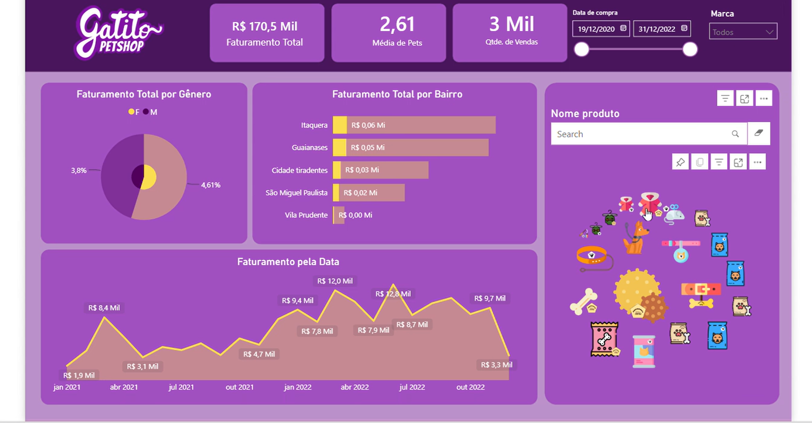

# 🐾 Dashboard de Vendas — Gatito PetShop (Power BI)

Dashboard desenvolvido em **Power BI** durante a formação da Alura. Ele analisa as vendas de um pet shop fictício para responder perguntas comerciais: quanto a loja fatura, quem são os clientes e onde estão as melhores oportunidades.



## 🔎 Principais números (dez/2020 a dez/2022)

| Faturamento total | Vendas | Média de pets por cliente |
|---:|---:|---:|
| **R$ 170,5 mil** | **3 mil** | **2,61** |

- **O faturamento mensal cresceu ao longo do período:** saiu de R$ 1,9 mil em janeiro de 2021 e chegou ao pico de **R$ 12,8 mil** em meados de 2022.
- **Itaquera é o bairro que mais fatura** (cerca de R$ 60 mil), seguido de Guaianases (cerca de R$ 50 mil). Juntos, os dois bairros concentram a maior parte das vendas da loja.

## 🎯 Perguntas de negócio
- Qual é o faturamento total e quantos produtos foram vendidos?
- Como o faturamento evolui ao longo do tempo (ano, trimestre, mês e dia)?
- Quais **bairros** concentram o maior faturamento?
- Como o faturamento se divide por **gênero** dos clientes?
- Quantos pets cada cliente tem, em média?
- Quais produtos e marcas aparecem em cada recorte?

## 📊 O que o dashboard mostra
| Visual | Objetivo |
|---|---|
| Cartões de KPI | Faturamento total, quantidade vendida e média de pets por cliente |
| Gráfico de área | Faturamento ao longo do tempo, com drill-down por ano, trimestre, mês e dia |
| Gráfico de barras | Faturamento por bairro |
| Gráfico de pizza | Faturamento por gênero dos clientes |
| Galeria de imagens | Fotos dos produtos, que reagem aos filtros |
| Filtros | Data de compra, marca e busca por nome de produto |

## 🛠️ Técnicas aplicadas
- **Power Query**: importação e tratamento das tabelas
- **Modelagem de dados**: relacionamento entre as tabelas `Vendas`, `Clientes` e `Produtos`
- **DAX**: medida `Faturamento Total`
- **Hierarquia de datas** para análise temporal com drill-down
- **Visuais personalizados**: filtro por texto e galeria de imagens dos produtos
- **Interatividade**: filtros cruzados entre todos os visuais

## ▶️ Como abrir
1. Baixe o arquivo `Dashboard.pbix`.
2. Abra no [Power BI Desktop](https://powerbi.microsoft.com/desktop/) (gratuito).

## 📂 Arquivos
```
├── Dashboard.pbix            # relatório do Power BI
├── imagens/dashboard.png     # print do painel
└── README.md
```
